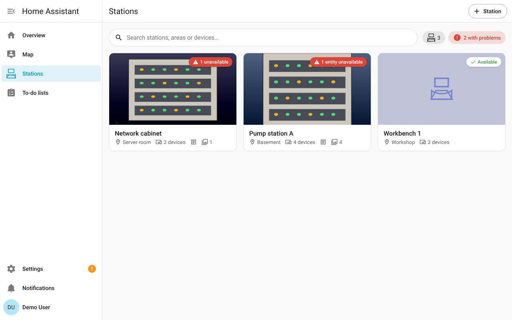
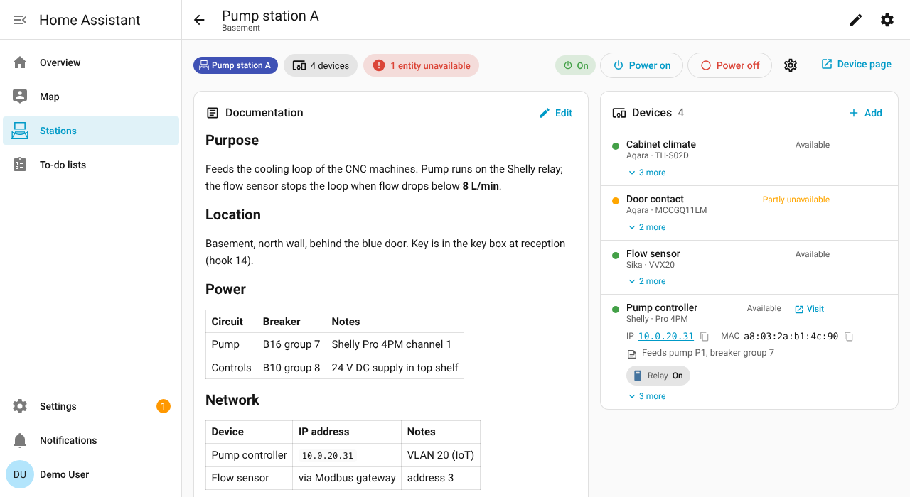
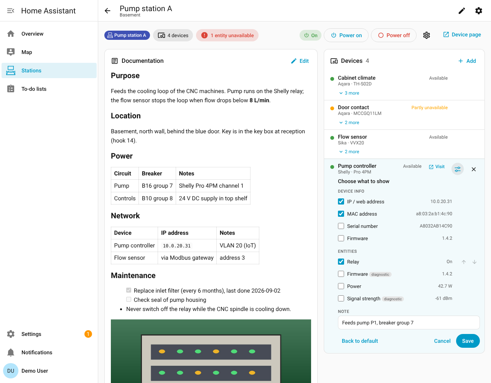
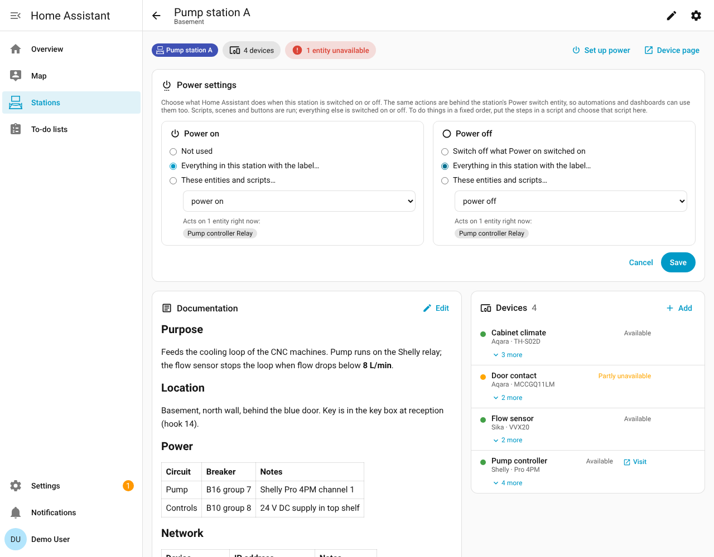

# Stations for Home Assistant

Group the devices that are built into one piece of furniture into a **station**, and keep the station's documentation (text, photos, datasheets) right next to the live status of its devices. Home Assistant becomes the single place to look.




## What you get

- **A "Stations" page in the sidebar.** It shows every station as a card with a cover photo, its area, how many devices it has, and a red badge when something in it is unavailable. The search box also finds stations by device name, so "where is the UPS?" is one search away. Sort the list by name, area or floor; sorted by area or floor, the stations are grouped under a heading per area or floor (floors in order of their level).
- **A station page** with:
  - **Devices**: every member device with a live status dot (available / partly unavailable / unavailable). Its entities are collapsed under "n more" until you choose what to show for that device. Click an entity to open the normal Home Assistant more-info dialog, or a device name to open its device page. Devices that have a **Visit** link on their Home Assistant device page (usually their own web interface) get the same **Visit** link here.
  - **Documentation**: free text in Markdown (headings, tables, checklists, links, code), edited in the browser. There is a starter template with sections for purpose, location, power, network, maintenance, contacts and changelog. Photos you uploaded can be placed inline in the text.
  - **Photos & files**: upload photos (JPEG, PNG, GIF, WebP), PDFs (datasheets, wiring diagrams) and text files. Select or drag several files at once, and on a phone the upload button can take a photo directly. Large photos are scaled down to 2560 px before upload, and files are sent in pieces of 512 KB, so uploads also work through tunnels and proxies that limit the size of a request. The overview and the gallery load small copies of the photos; the full photo opens in the viewer. Every file can have a caption, the order can be changed, and one photo is the cover shown on the overview.
- **A device per station** under Settings → Devices & services, with three entities:
  - `sensor.<station>_devices`: number of member devices. Its `entity_id` attribute lists every member entity, so `expand('sensor.<station>_devices')` works in templates like it would for a group.
  - `sensor.<station>_unavailable_devices`: number of member devices that are completely unavailable, with their names as an attribute.
  - `binary_sensor.<station>_status` (problem): on when any member entity is unavailable, with an `unavailable_entities` attribute.

  - `switch.<station>_power`: runs the station's power on / power off actions (see below).

  The station device's page has a **Visit** link that opens the station page.

## Choose what to show per device

Every device on a station page has a **Choose what to show** button (the sliders icon, visible when you hover over the device). In it you tick exactly what that device should show:

- **Device info**: IP / web address, MAC address, Zigbee address, serial number, firmware and hardware version, as far as Home Assistant knows them. The IP is a link to the device's web interface, and every value has a copy button.
- **Entities**: tick the readings to show as chips and put them in the order you like. By default none are ticked: a device shows its name, status and model, with all its entities collapsed under "n more".
- **Note**: one short line shown with the device, for anything Home Assistant does not know (for example "port 3 on the switch" or a fixed IP address).

So "show only the IP address" is: tick IP / web address, untick all entities, save. **Back to default** removes the custom settings. The settings belong to the device in that station and are the same for every user.



## Power on and power off

A new station is set up for power straight away: the form to create a station has a **Power on label** and a **Power off label**, filled in with the labels `Power on` and `Power off`. They are created when they don't exist yet, and every station shares them. Clear a field for a station without power control.

To change it later, click **Set up power** (or the cog) on a station page (admins) and choose, separately for power on and power off:

- **Everything in this station with the label…**: for example your existing `power on` and `power off` labels. Only members of this station are affected, so the same two labels work for every station. A label on a single entity selects that entity; a label on a whole device selects its switches, lights and similar on/off entities.
- **These entities and scripts…**: a fixed list, which may also contain things outside the station.
- For power off you can also choose **Switch off what Power on switched on**. This is also what happens when power off uses a label that nothing in the station carries.

Scripts, scenes and buttons are run; switches, lights and the like are switched on or off. If the steps must happen in a fixed order (power supply first, then the controller), put them in a script and choose that script. The settings screen shows which entities the choice acts on right now.

The **Power on / Power off** buttons on the station page ask for confirmation first. The same actions are behind `switch.<station>_power`, so you can use them on dashboards and in automations. That switch is on when any of the switchable power-on targets is on.



## How membership works: labels

Each station is linked to one **label**. Any device that carries that label is part of the station, and so is any single entity that carries it (useful for a helper, a template sensor, or one entity of a device that otherwise lives elsewhere).

You can add a device to a station in three ways. They all do the same thing:

1. On the station page, click **Add** and pick a device or entity (admins only).
2. On the device's own page in Home Assistant, add the station's label.
3. In Settings → Devices & services → Devices, select several devices and apply the label in one go.

Changes show up immediately. A device can be in more than one station if it carries more than one station label. When you create a station without choosing a label, a label with the station's name is created for you.

## Installation

### HACS (custom repository)

1. In HACS, open the three-dot menu and choose **Custom repositories**.
2. Add `https://github.com/definexperience/ha-stations` and choose type **Integration**.
3. Install **Stations** and restart Home Assistant.

HACS shows an update whenever a new release is published. HACS only works with public repositories; if the repository is private, use the manual installation below.

### Manually

1. Copy `custom_components/stations` into the `custom_components` folder of your Home Assistant config directory, so you end up with `<config>/custom_components/stations/manifest.json`.
2. Restart Home Assistant.

### Create your first station

1. Go to **Settings → Devices & services → Add integration** and search for **Stations**.
2. Enter a name, optionally pick an existing label and the area where the station stands, and check the power on / power off labels. A label that another station already uses is refused with the name of that station.
3. Repeat for every station. The **Stations** entry appears in the sidebar after the first one.

You can also start a new station with the **+ Station** button at the top of the Stations page.

## Who can do what

| Action | All users | Admins only |
|---|---|---|
| View stations, documentation and files | ✓ | |
| Edit documentation, upload, caption, reorder and delete files | ✓ | |
| Choose what to show per device | ✓ | |
| Power a station on or off | ✓ | |
| Set up what power on / power off do | | ✓ |
| Add or remove devices and entities | | ✓ |
| Rename a station, create or remove stations, change the label | | ✓ |

If two people edit the same documentation at the same time, the second one to save gets a warning and can choose to overwrite or to load the other person's version. Nothing is lost silently.

## Where the data lives

- Documentation text: `<config>/.storage/stations.docs`
- Photos and files: `<config>/stations/<station id>/`

Both are inside the Home Assistant config folder, so they are included in normal Home Assistant backups. Files are served only to logged-in users, through short-lived signed links.

Removing a station deletes its documentation and files. The label stays, because you may be using it elsewhere.

## Examples

**Notify when a station has a problem**

```yaml
automation:
  - alias: "Station problem"
    triggers:
      - trigger: state
        entity_id:
          - binary_sensor.pump_station_a_status
          - binary_sensor.network_cabinet_status
        to: "on"
        for: "00:05:00"
    actions:
      - action: notify.notify
        data:
          title: "{{ trigger.to_state.name }}"
          message: >
            Unavailable: {{ state_attr(trigger.entity_id, 'unavailable_entities') | join(', ') }}
```

**Turn off everything in a station**

Because membership is a label, you can target the whole station in any action:

```yaml
action: switch.turn_off
target:
  label_id: pump_station_a
```

**Link a photo inside the documentation**

Use the **Insert photo or file…** menu in the editor. It adds ``, which is shown as the photo.

## Logo

- **Sidebar and icons:** the Stations sidebar entry, the station counter and the station sensors use the logo as a single-colour icon (`stations:logo`). It follows your theme colours like other icons, and you can pick it as an icon anywhere in Home Assistant, for example for a label.
- **Integrations and devices pages:** from Home Assistant 2026.3, Home Assistant shows the full-colour logo from the `brand` folder on the integrations and devices pages, with a light version on dark themes. Older versions show a placeholder there; everything else works the same.
- **Editing:** the source drawings are `docs/logo.svg` and `docs/logo-dark.svg`.

## Requirements

Home Assistant 2025.2 or newer. Tested with 2026.2.

## Running the tests

```bash
pip install -r requirements_test.txt
pytest
```

## Releasing a new version

1. Bump `version` in `custom_components/stations/manifest.json` and commit.
2. Push a tag with the same version, for example `git tag v1.2.3 && git push origin v1.2.3`.
3. The **Release** workflow checks that the tag matches the manifest and publishes a GitHub release. HACS installations then offer the update.

The **Validate** workflow runs hassfest, the HACS checks and the test suite on every push.

## Licence

MIT, see [LICENSE](LICENSE). Made by deFine.
